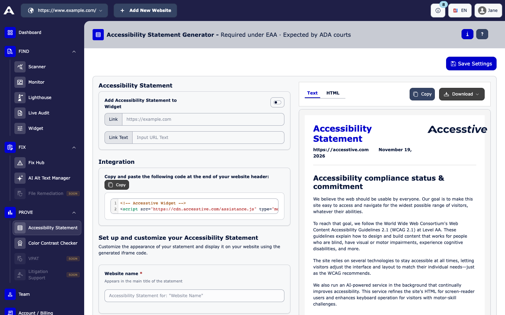

An accessibility statement tells visitors how accessible your website is and how to contact you about problems. It is required under the European Accessibility Act (EAA) for many businesses, and courts in the US expect one under the ADA.

## Create your statement

<Steps>
  <Step title="Open the generator">
    Go to **PROVE** → **Accessibility Statement**.
  </Step>
  <Step title="Fill in the details">
    Under **Set up and customize your Accessibility Statement**, enter:

    - **Website name** (required): appears in the title of the statement
    - **Contact Information** (required): **Contact email**, **Contact phone**, and **Address** where visitors can report problems
    - **Number of business days to respond**, for example 5
    - **Last audit date**
  </Step>
  <Step title="Check the preview">
    The preview on the right updates as you type. Switch between **Text** and **HTML**.
  </Step>
  <Step title="Save">
    Click **Save Settings**.
  </Step>
</Steps>

<Frame caption="PROVE → Accessibility Statement">
  
</Frame>

## Put the statement on your website

Choose one way:

- **Copy** the text or HTML and paste it into a page on your website.
- **Download** it as HTML (**Download HTML**) or plain text (**Download Text**).
- Use the code under **Integration**. Paste it at the end of your website header.

## Show the statement in the widget

1. Turn on **Add Accessibility Statement to Widget**.
2. Enter the **Link** to the page with your statement, and the **Link Text** visitors should see.
3. Click **Save Settings**.

Visitors can now open your statement from the [Accessibility Widget](/widget).

<Note>
  A statement documents your work and your contact options. It is not proof of legal compliance. Keep it up to date after each audit.
</Note>
