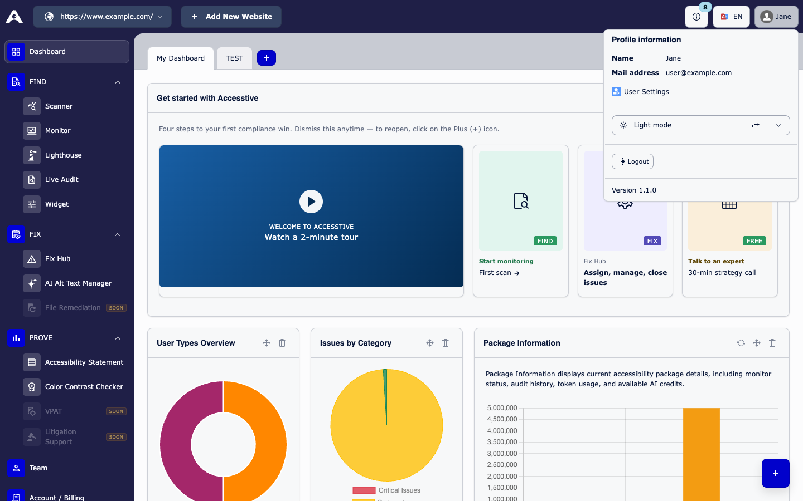

## Your profile menu

Click your profile icon in the top right corner. The menu shows your **Profile information** (**Name**, **Mail address**, and **Phone number**) and links to:

- **User Settings**, where you change your password and personal settings
- A switch between the light and dark dashboard look
- **Logout**

<Frame caption="The profile menu in the top bar">
  
</Frame>

## Change the dashboard language

Use the language switch in the top bar to show the dashboard in English or German.

## Switch between websites

If you have more than one website, use **Domains** in the top bar to switch between them. Every module then shows data for the website you chose. To add a website, see [Plans and billing](/billing#add-another-website).

## Delete your account

<Warning>
  Deleting your account removes all your data within 30 days. You cannot get it back.
</Warning>

<Steps>
  <Step title="Open the form">
    Open the **Delete My Account** page and fill in the **Account Deletion Request** form. If you cannot find it in the dashboard, email [info@accesstive.com](mailto:info@accesstive.com).
  </Step>
  <Step title="Fill in the form">
    Enter your **Full Name** and **Email Address**, type your current password in **Confirm Password**, and choose a **Reason for Deletion**. Submit the form.
  </Step>
  <Step title="Confirm by email">
    You get an email with a confirmation link. Click it to confirm. After that, your account is scheduled for deletion.
  </Step>
</Steps>

Good to know:

- You can send only one deletion request per day.
- If a request is already open, you see "You already have a pending account deletion request."
- If the link has expired, request a new one.
- Cancel any paid plan first in [Account / Billing](/billing#cancel-your-subscription) so you are not charged again.

{/* TODO for product team: the Delete Account entry is not in the profile menu or reachable for the test user. Add a visible link. Also, the deletion code does not cancel the Stripe subscription. Confirm whether support cancels it, then update this page. */}
