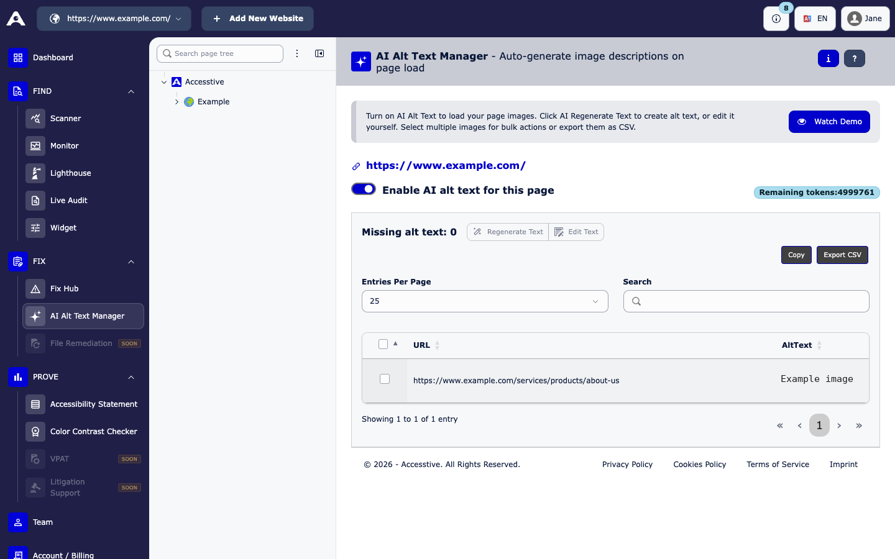

Alt text is a short description of an image. Screen readers read it out to people who cannot see the image. The **AI Alt Text Manager** finds images on your pages that have no alt text and helps you write it with AI.

<Note>
  The AI Alt Text Manager needs the [Accessibility Widget](/widget) on your website. AI features use AI tokens from your plan. The Solo plan has no AI tokens, so the AI switch is hidden there.
</Note>

## Create alt text

<Steps>
  <Step title="Open the module">
    Go to **FIX** → **AI Alt Text Manager**.
  </Step>
  <Step title="Choose a page">
    Click a page in the page tree.
  </Step>
  <Step title="Turn on AI alt text">
    Switch on **Enable AI alt text for this page**. The images of the page load into a table with **URL**, **AltText**, and **Actions**. The page shows how many images have **Missing alt text**.
  </Step>
  <Step title="Create or edit the text">
    For one image, click **Generate alt text with AI**, or click **Edit alt text** to write it yourself. Then click **Save alt text**.
  </Step>
</Steps>

<Frame caption="FIX → AI Alt Text Manager">
  
</Frame>

## Work on many images at once

1. Tick the images you want to change.
2. Click **Regenerate Text** to create alt text with AI, or **Edit Text** to write it yourself.
3. Click **Save selected**.

You can also export the list as a CSV file.

## Tips for good alt text

- Describe what the image shows and why it matters on the page.
- Keep it short, usually one sentence.
- Do not start with "Image of".
- Always check AI text before you save it.

The number of **Remaining tokens** is shown on the page. Starter includes 0.5M tokens per month, Business 2M, and Growth 5M. If you run out, upgrade your plan in [Plans and billing](/billing
