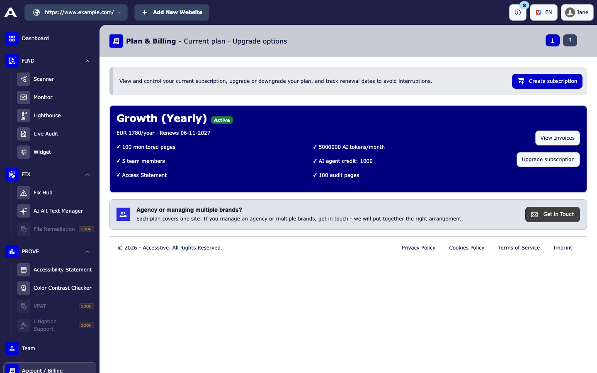

Accesstive plans are priced by the number of pages, not by website traffic. Each plan covers **one website**. You manage everything under **Account / Billing** in the dashboard.

For current prices, see [accesstive.com/pricing](https://accesstive.com/pricing/). You can pay monthly or yearly. Yearly billing costs less.

{/* TODO for product team: prices in the local plan data (Solo 16, Starter 49, Business 139, Growth 179 EUR/month) differ from the old docs (Starter 40, Business 115, Growth 198). Confirm before adding prices here. */}

## What each plan includes

| | Solo | Starter | Business | Growth |
| --- | --- | --- | --- | --- |
| Best for | Accessibility essentials and light monitoring | Continuous monitoring | Fully managed accessibility | Multi-site teams |
| Websites | 1 | 1 | 1 | 1 |
| Widget on up to | 100 pages | 1,500 pages | 10,000 pages | 100,000 pages |
| Monitored pages | 1 | 10 | 50 | 100 |
| Live Audit | Home page only | 10 pages | 50 pages | 100 pages |
| Team members | Owner only | 1 | 3 | 5 |
| AI tokens (Fix with AI, alt text) | Not included | Included | Included | Included |
| White-label widget branding | No | No | No | Yes |

Every paid plan includes the [Accessibility Widget](/widget), [Scanner and Monitor](/monitor), [Live Audit](/live-audit), [Fix Hub](/fix-hub), the [Accessibility Statement](/accessibility-statement) generator, and the [Color Contrast Checker](/contrast-checker).

The **Free** plan lets you try the dashboard with limited features. It does not include monitored pages.

{/* TODO for product team: please confirm the table above. It is based on the plan settings in the dashboard code. "Starter (Yearly)" lists 10 websites in the plan data, while the dashboard says "Each plan covers one site". */}

## Free trial

Paid plans start with a **14-day free trial**. A banner in the dashboard shows how many trial days are left. When the trial ends, choose a plan to keep using paid features.

## See your plan

Open **Account / Billing**. Your plan card shows:

- Your plan name, status (for example **Active**, **Trial Active**, or **Expired Plan**), and renewal date (**Renews**)
- Your usage: monitored pages, audit pages, team members, and AI tokens

Click the plan to open **Subscription Details**. It shows the activation and expiry date, remaining days, **Associated Websites**, and **Usage Metrics** (available usage compared to allowed usage).

<Frame caption="Account / Billing: your current plan">
  
</Frame>

<Frame caption="Account / Billing → View Invoices">
  
</Frame>

## Subscribe or upgrade

<Steps>
  <Step title="Choose a plan">
    In **Account / Billing**, pick **Monthly** or **Annual** and choose a plan. Click **Subscribe Now**, **Activate Plan**, or **Upgrade Subscription**.
  </Step>
  <Step title="Pay">
    Enter your payment details in the secure Stripe payment form and confirm. Wait while the message "Just a moment, we're processing your payment." is shown.
  </Step>
  <Step title="Done">
    Your new plan is active right away. Your new limits show on the plan card.
  </Step>
</Steps>

If you are already on **Growth**, the highest plan, the page says so. For custom limits, contact the team.

<Frame caption="The Upgrade subscription window. On the highest plan it shows that there is nothing higher to upgrade to.">
  
</Frame>

## Invoices

Open **Account / Billing** and click **View Invoices**. You see each payment with its plan, site, amount, and dates, and you can download the invoice.

## Cancel your subscription

The plan card does not have a cancel button yet. To cancel, email [info@accesstive.com](mailto:info@accesstive.com).

{/* TODO for product team: cancelSubscriptionAction exists in code but no button or link calls it. Add the button, then document it here. */}

After cancelling, your plan stays active until the end of the period you already paid for. After that, its status changes to **Canceled** and paid features stop.

## Renew an expired plan

If your plan ended, the dashboard shows "Your subscription has ended." Click **Renew** in the top bar, or **Renew subscription** in **Account / Billing**.

## Add another website

Each plan covers one website. To add another website, click **Add New Website** in **Account / Billing** (or in the website switcher at the top), then choose a plan for it.

If you are an agency or manage several brands, choose **Get in Touch** on the billing page for a custom offer.

## Money-back guarantee

After you subscribe, you can ask for a refund within **10 days** if you are not happy. Email [info@accesstive.com](mailto:info@accesstive.com).

## Agency and Enterprise

- **Agency partnership**: volume pricing, white-label reports, and central management.
- **Enterprise**: custom page limits, custom AI credits, SSO, and on-premise or self-hosted options.

Ask for a quote on the [pricing page](https://accesstive.com/pricing/).

## Experts and add-ons

From the **Business** plan up, you can book human experts for audits, fixes, VPAT/ACR documents, and help after a legal complaint. See [Human Expert Audit](/human-expert-audit) and [Expert Services](https://accesstive.com/expert-services/).

## Support

- Email: [info@accesstive.com](mailto:info@accesstive.com)
- Phone: +49 351 48 19 66 61
- [Schedule a demo](https://calendly.com/accesstive)
