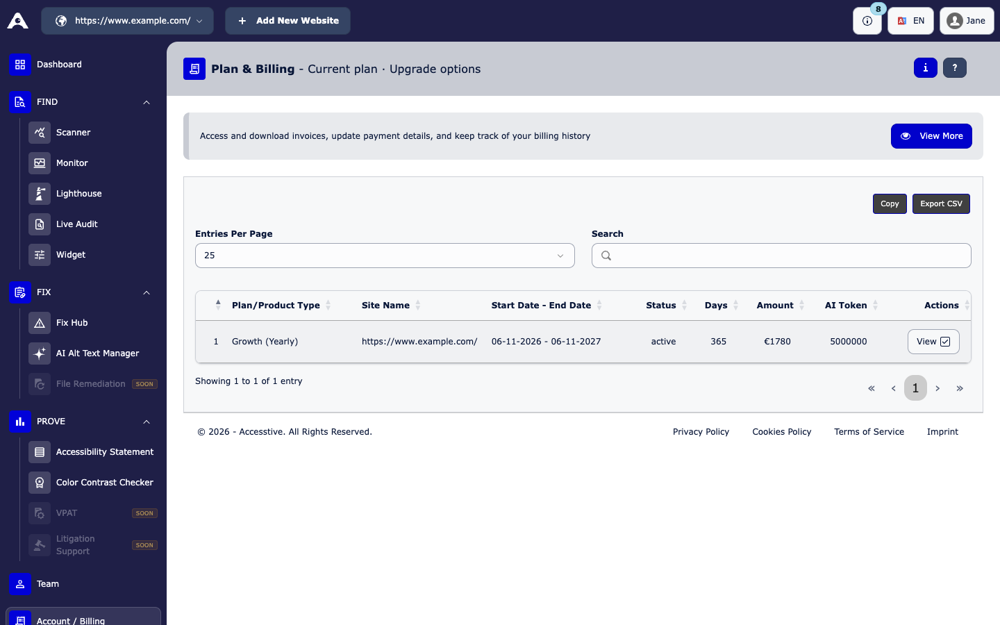

Accesstive plans are priced by the number of pages, not by website traffic. You manage your plan under **Account / Billing** in the dashboard.

## Prices

Prices change from time to time, so they are not listed here. See the current prices for monthly and annual billing on the [pricing page (opens in a new tab)](https://accesstive.com/pricing/).

## What each plan includes

| | Solo | Starter | Business | Growth |
| --- | --- | --- | --- | --- |
| Best for | Accessibility essentials | Continuous monitoring | Fully managed accessibility | Multi-site teams |
| Accessibility Widget | Up to 100 pages | Up to 1,500 pages | Up to 10,000 pages | Up to 100,000 pages |
| Monitoring (checked daily) | 1 page (your home page) | 10 pages | 50 pages | 100 pages |
| Live Audit | Home page only | AI-powered, every page | AI + human review, every page | AI + human review, every page |
| AI fix recommendations (**Fix with AI**) | No | Yes | Yes | Yes |
| AI tokens (for AI fixes and audits) | None | 500,000 / month | 2 million / month | 5 million / month |
| Human remediation support | No | No | On demand | Priority access |
| Monthly audit reports (PDF export) | Yes | Yes | Yes | Yes |
| Accessibility Conformance Report | No | No | Included | Included |
| White-label widget and reporting (your own brand instead of Accesstive's) | No | No | No | Yes |
| Users | 1 | 1 | 3 | 5 |
| Dedicated manager | No | No | Yes | Yes |
| Two-factor authentication (2FA) and single sign-on (SSO) | No | No | No | Yes |
| Support | Limited | Email and chat | Priority | Priority |

**AI tokens** are the amount of AI help included in your plan. Each AI request, such as **Fix with AI** or creating alt text, uses some tokens. 2FA adds an extra step when you sign in. SSO lets your team use one login for several tools.

All plans include the dashboard, [Accessibility Statement](/accessibility-statement) generator, and [Color Contrast Checker](/contrast-checker). VPAT/ACR documentation (VPAT is a standard form for an Accessibility Conformance Report, or ACR, which companies often ask for when they buy software), litigation support, and PDF remediation are available as paid services.

Each plan covers **1 website**, on monthly and yearly billing. To add more websites, choose a plan for each extra site. See the [pricing page (opens in a new tab)](https://accesstive.com/pricing/).

## Free trial

New sign-ups get a **14-day Starter trial**, no card needed. A banner in the dashboard shows how many trial days are left. When the trial ends, choose a plan to keep using paid features.

Plans bought in the dashboard are charged right away.

## See your plan

Open **Account / Billing**. Your plan card shows:

- Your plan name, status (for example **Active**, **Trial Active**, or **Expired Plan**), and renewal date (**Renews**)
- Your usage: monitored pages, audit pages, team members, and AI tokens

Click the plan to open **Subscription Details**. It shows the activation and expiry date, remaining days, **Associated Websites**, and **Usage Metrics** (available usage compared to allowed usage).

<Frame caption="Account / Billing: your current plan">
  
</Frame>

## Subscribe or upgrade

<Steps>
  <Step title="Choose a plan">
    In **Account / Billing**, pick **Monthly** or **Annual** and choose a plan. Click **Subscribe Now**, **Activate Plan**, or **Upgrade Subscription**.
  </Step>
  <Step title="Pay">
    Enter your payment details in the secure Stripe payment form and confirm. Wait while the message "Just a moment, we're processing your payment." is shown.
  </Step>
  <Step title="Done">
    Your new plan is active right away. Your new limits show on the plan card.
  </Step>
</Steps>

If you are already on **Growth**, the highest plan, the page says so. For custom limits, contact the team.

<Frame caption="The Upgrade subscription window. On the highest plan it shows that there is nothing higher to upgrade to.">
  
</Frame>

## Invoices

Open **Account / Billing** and click **View Invoices**. You see each payment with its plan, site, amount, and dates, and you can download the invoice.

<Frame caption="Account / Billing → View Invoices">
  
</Frame>

## Renew an expired plan

If your plan ended, the dashboard shows "Your subscription has ended." Checks, Live Audit, and adding teammates stop until you renew. Click **Renew** in the top bar, or **Renew subscription** in **Account / Billing**.

## Add another website

Click **Add New Website** in **Account / Billing** (or in the website switcher at the top). Each plan includes one website. To add another website, you usually need another plan, unless your offer already includes extra sites.

If you are an agency or manage several brands, choose **Get in Touch** on the billing page for a custom offer.

## Agency and Enterprise

- **Agency partnership**: volume pricing, white-label reports (with your own brand name and logo instead of Accesstive's), and central management.
- **Enterprise**: custom page limits, custom AI tokens, SSO, and the option to run Accesstive on your own servers.

Ask for a quote on the [pricing page (opens in a new tab)](https://accesstive.com/pricing/).

## Experts and add-ons

Accesstive experts can audit your site by hand, help fix issues, create VPAT/ACR documents, and help after a legal complaint. See [Human Expert Audit](/human-expert-audit) and [Expert Services (opens in a new tab)](https://accesstive.com/expert-services/).

## Support

- Email: [info@accesstive.com](mailto:info@accesstive.com)
- [Schedule a demo (opens in a new tab)](https://calendly.com/accesstive)
