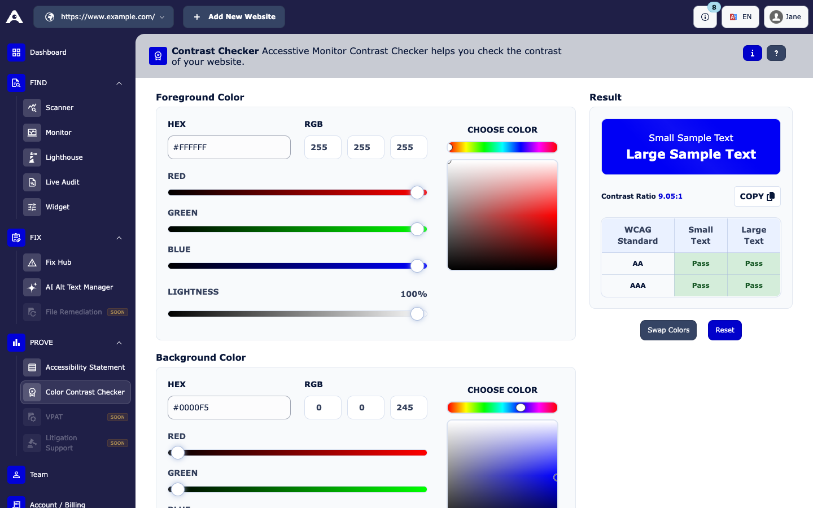

Text must stand out clearly from its background so everyone can read it, including people with low vision. The **Color Contrast Checker** tells you whether two colors are readable according to WCAG. WCAG (the Web Content Accessibility Guidelines) are the international rules for accessible websites. A, AA, and AAA are the levels of those rules. AA is the usual target, and AAA is stricter.

## Check two colors

<Steps>
  <Step title="Open the checker">
    Go to **PROVE** → **Color Contrast Checker**.
  </Step>
  <Step title="Enter your colors">
    Set the **Foreground Color** (your text) and the **Background Color**. Type a **Hex** or **RGB** value, or use **Choose Color**. You can also adjust **Red**, **Green**, **Blue**, and **Lightness**.
  </Step>
  <Step title="Read the result">
    The **Result** shows the **Contrast Ratio** and whether it passes **AA** and **AAA** for **Small Text** and **Large Text**. Sample text shows how it looks.
  </Step>
</Steps>

<Frame caption="PROVE → Color Contrast Checker">
  
</Frame>

Use **Swap Colors** to switch text and background, **Copy** to copy a value, and **Reset** to start again.

## What ratio do I need?

| WCAG level | Normal text | Large text |
| --- | --- | --- |
| AA | at least 4.5:1 | at least 3:1 |
| AAA | at least 7:1 | at least 4.5:1 |

Large text means at least 24 px regular, or about 19 px bold.
