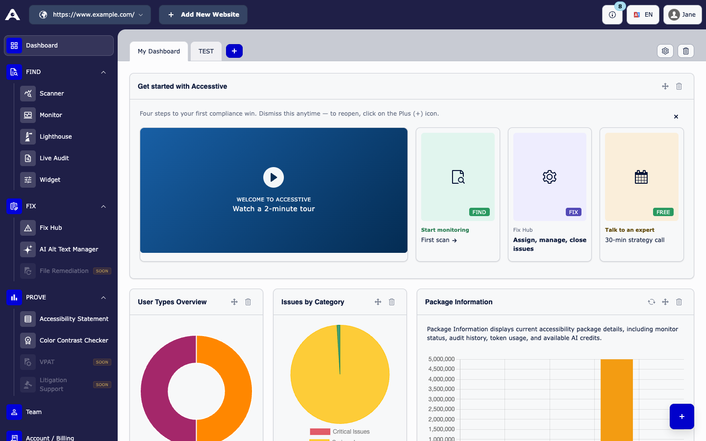
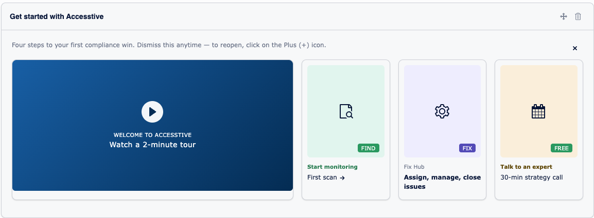

The Accesstive dashboard is where you check your website, fix issues, and manage your account. Open it at [dashboard.accesstive.com/app](https://dashboard.accesstive.com/app/) and sign in.

<Frame caption="The Accesstive dashboard">
  
</Frame>

## The left menu

The menu follows three steps: find problems, fix them, and prove your work.

| Menu | Module | What you do there |
| --- | --- | --- |
| **FIND** | **Scanner** | Check a page now and see its accessibility rating and issues. See [Scanner and Monitor](/monitor). |
| | **Monitor** | Choose single pages to check again and again. See [Scanner and Monitor](/monitor). |
| | **Lighthouse** | Get performance, accessibility, SEO, and best-practice scores per page. See [Lighthouse](/lighthouse). |
| | **Live Audit** | See issues highlighted on a live page. See [Live Audit](/live-audit). |
| | **Widget** | Set up and install the Accessibility Widget. See [Accessibility Widget](/widget). |
| **FIX** | **Fix Hub** | Assign, track, and close issues. See [Fix Hub](/fix-hub). |
| | **AI Alt Text Manager** | Create image descriptions with AI. See [AI Alt Text Manager](/alt-text). |
| | **Human Expert Audit** | Book an accessibility specialist. See [Human Expert Audit](/human-expert-audit). |
| **PROVE** | **Accessibility Statement** | Create your accessibility statement. See [Accessibility Statement](/accessibility-statement). |
| | **Color Contrast Checker** | Test two colors against WCAG. See [Color Contrast Checker](/contrast-checker). |
| **Team** | | Add teammates and manage their access. See [Team](/team). |
| **Account / Billing** | | Your plan, upgrades, invoices, and websites. See [Plans and billing](/billing). |

Items marked **SOON** in the menu (File Remediation, VPAT, and Litigation Support) are not available yet.

Some modules, such as Scanner, Monitor, Lighthouse, Live Audit, and AI Alt Text Manager, show a page tree next to the menu. Click your website or one of its pages in the tree to choose what you want to work on.

<Tip>
  What you can use depends on your plan. If a feature is not part of your plan, the dashboard shows an **Upgrade** button. See [Plans and billing](/billing).
</Tip>

## The Dashboard home page

After you sign in, you see the **Dashboard**. It shows small panels (widgets) with an overview of your website, such as:

- The **Get started with Accesstive** onboarding strip
- Your site score and issues over time
- Issues by severity and by category
- Lighthouse overview
- Your plan details
- A link to book a demo

The panels you see depend on your plan and on how far you are with setup.

## Onboarding strip

When you first sign in, the **Get started with Accesstive** strip shows four steps to your first result:

1. **Welcome to Accesstive**: watch a 2-minute tour.
2. **First scan**: click **Start monitoring** to open the Scanner and check your site.
3. **Fix Hub**: assign, manage, and close issues.
4. **Talk to an expert**: book a free 30-minute strategy call.

You can close the strip at any time. To open it again, click the Plus (+) icon.

<Frame caption="The onboarding strip">
  
</Frame>

## Top toolbar

At the top of the dashboard you can:

- Switch between your websites (**Domains**) or add a new website
- Change the dashboard language (English or German)
- Open your notifications. See [Notifications and emails](/notifications).
- Open the **Help** menu. It links to **Book a demo**, the **Help Center**, **Support ticket**, **Integrations**, and the **Free accessibility checker**.
- Open your profile menu. It shows your **Profile information** and links to **User Settings** and **Logout**. See [Profile and account](/account).
- See **Upgrade** or **Renew** buttons when your plan needs attention. See [Plans and billing](/billing).

## Interactive tours

Guided tours point out the main areas of the dashboard, step by step: the dashboard, **Add New Website**, your profile, the widget, Live Audit, Monitor, Lighthouse, and Account. Use them when you are new or want a quick refresher.

## Get help in the dashboard

A chat button at the bottom of the dashboard connects you with the Accesstive support team.

## Related guides

- [Getting started](/getting-started)
- [Scanner and Monitor](/monitor)
- [Fix Hub](/fix-hub)
- [Plans and billing](/billing)
- [Notifications and emails](/notifications)
