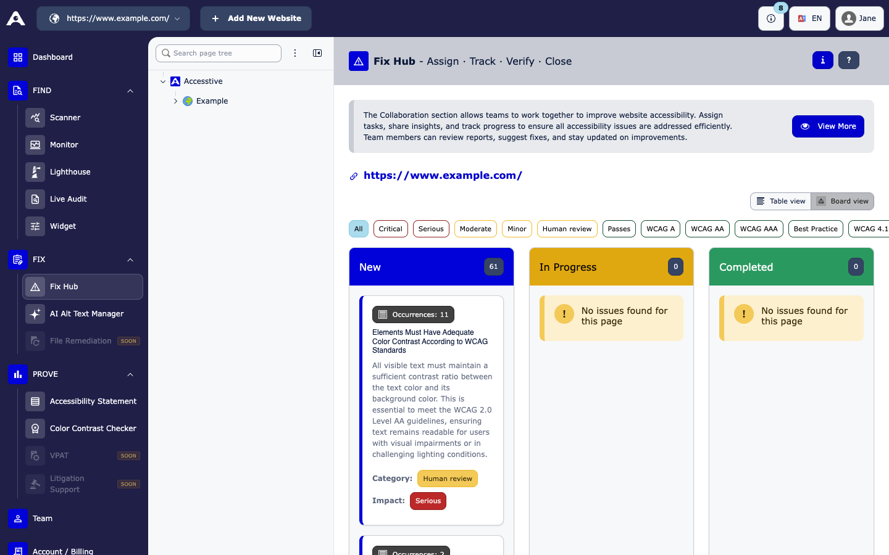
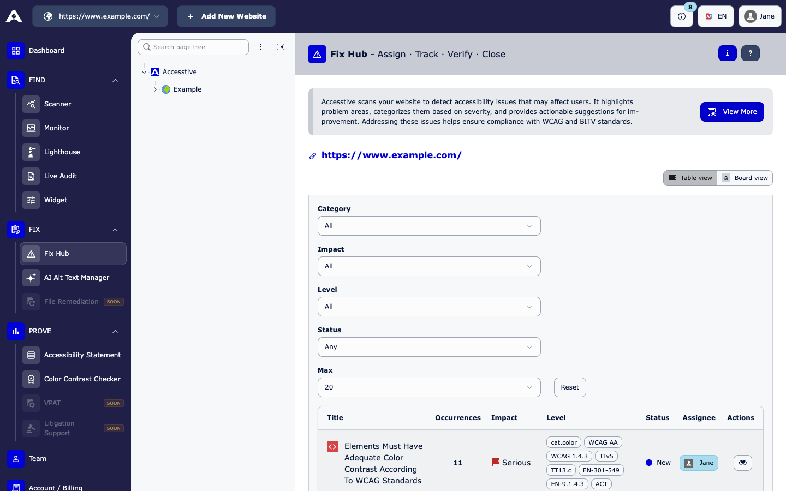
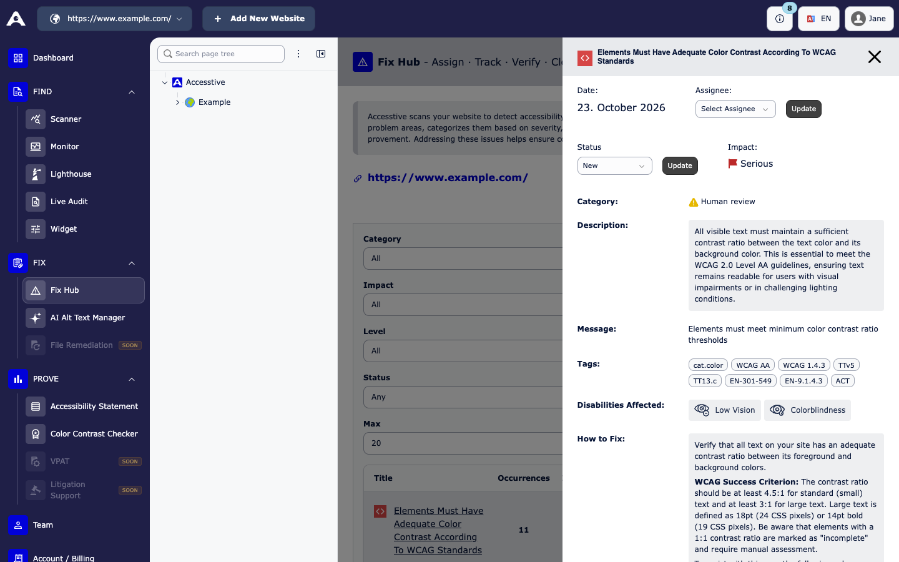

**Fix Hub** collects every issue found by the [Scanner and Monitor](/monitor) in one place. You decide who fixes what, follow progress, and mark issues as done. Its motto is **Assign · Track · Verify · Close**.

## Open Fix Hub

1. Go to **FIX** → **Fix Hub**.
2. Choose how to see your issues:
   - **Table view**: a list you can sort and filter
   - **Board view**: cards in three columns: **New**, **In Progress**, and **Completed**

Fix Hub is empty until you have checked at least one page. Run a check in **FIND** → **Scanner** first.

<Frame caption="Fix Hub in Board view">
  
</Frame>
<Frame caption="Fix Hub in Table view">
  
</Frame>

## Find the right issues

Use the filters to narrow the list:

- **Category**: **Errors**, **Needs Review**, or **Passes**
- **Impact**: **Critical**, **Serious**, **Moderate**, **Minor**, **Human review**, or **Passed**
- **WCAG level**: A, AA, AAA, or **Best Practice**
- **Assignee** and **Status**

Fix **Critical** and **Serious** issues first. They block people the most.

## Open an issue

Click an issue to open its details. You see:

- **Description**, **Why It Matters**, and **How to Fix**
- **Disabilities Affected**
- **Guidelines** (the WCAG rule) and a **Helpful URL**
- **Affected Code**, the **Target** element, and a **Screenshot**
- **Occurrences**: how often the issue appears

Use **Expand All** and **Collapse All** to open or close all sections of the issue at once.

<Frame caption="Issue details">
  
</Frame>

## Assign and track work

<Steps>
  <Step title="Assign the issue">
    In the issue details, use **Select Assignee** to pick a teammate. Add teammates first in [Team](/team).
  </Step>
  <Step title="Set the status">
    Set **Status** to **New**, **In-Progress**, or **Complete**, then click **Update**. In **Board view** you can also drag a card to another column.
  </Step>
</Steps>

## Fix with AI

<Steps>
  <Step title="Ask the AI">
    In the issue details, click **Fix with AI**. Accesstive creates an **AI-Generated Solution** with an **Explanation** and **AI-Generated Code**.
  </Step>
  <Step title="Check the answer">
    Read the suggestion carefully. If it does not fit, click **Regenerate with AI**.
  </Step>
  <Step title="Apply the fix yourself">
    Copy the code and apply it in your own website. Accesstive never changes your website code by itself.
  </Step>
</Steps>

Each AI request uses AI tokens from your plan (see [Plans and billing](/billing#what-each-plan-includes)). The panel shows **Token used for this request** and **Remaining token**. If you see "Insufficient tokens.", upgrade your plan in [Account / Billing](/billing).

## Verify and close

Fix Hub does not close issues by itself. You decide when an issue is done.

<Steps>
  <Step title="Deploy the fix">
    Your developer applies the fix on your website.
  </Step>
  <Step title="Check the page again">
    Click **Run Accessibility Check** in **FIND** → **Scanner**, or wait for the next daily Monitor check.
  </Step>
  <Step title="Close what is gone">
    If the issue no longer appears in the new results, set it to **Complete** yourself.
  </Step>
</Steps>

<Warning>
  **What a re-check does to your issues:**

  - Issues that are **still found** go back to **New** and **Unassigned**, even if you had assigned them or set them to In-Progress or Complete.
  - Issues that are **no longer found** are not closed automatically. They keep their current status until you change it.

  Note who works on what before you run a new check, so you can assign the issues again if needed.
</Warning>

Completed issues show the work your team has done. This record is not a legal compliance certificate.

## Related

- [Scanner and Monitor](/monitor) to find new issues
- [Live Audit](/live-audit) to see an issue on the live page
- [Team](/team) to add people you can assign
- Product page: [Fix Hub](https://accesstive.com/fix-hub/)
