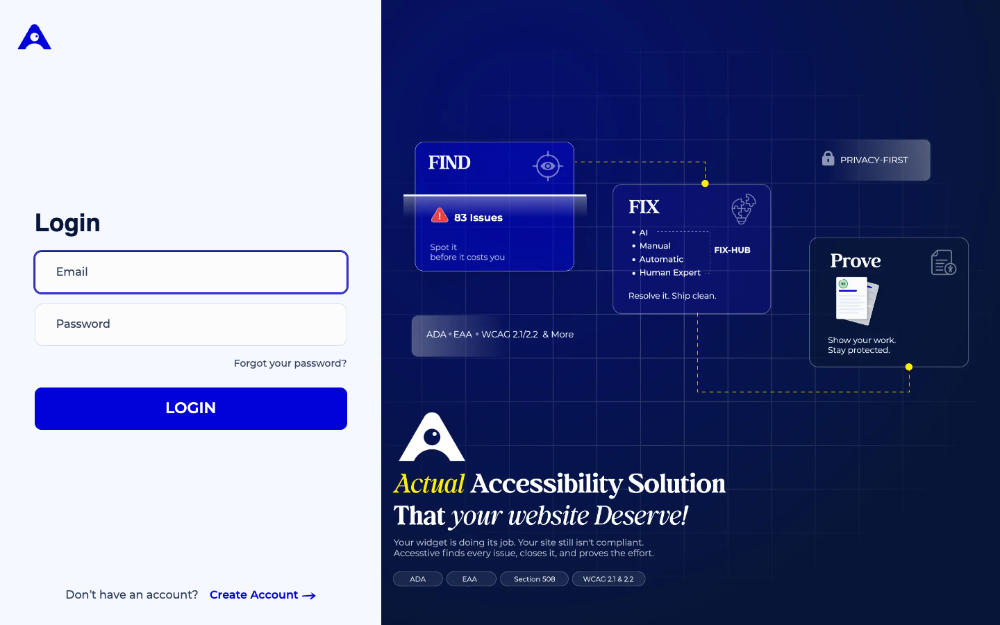
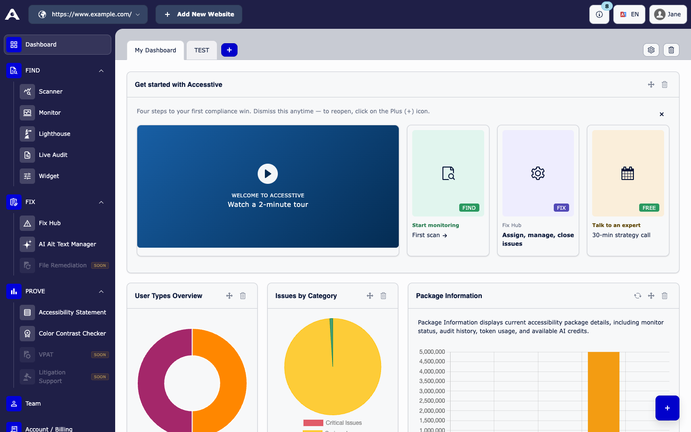
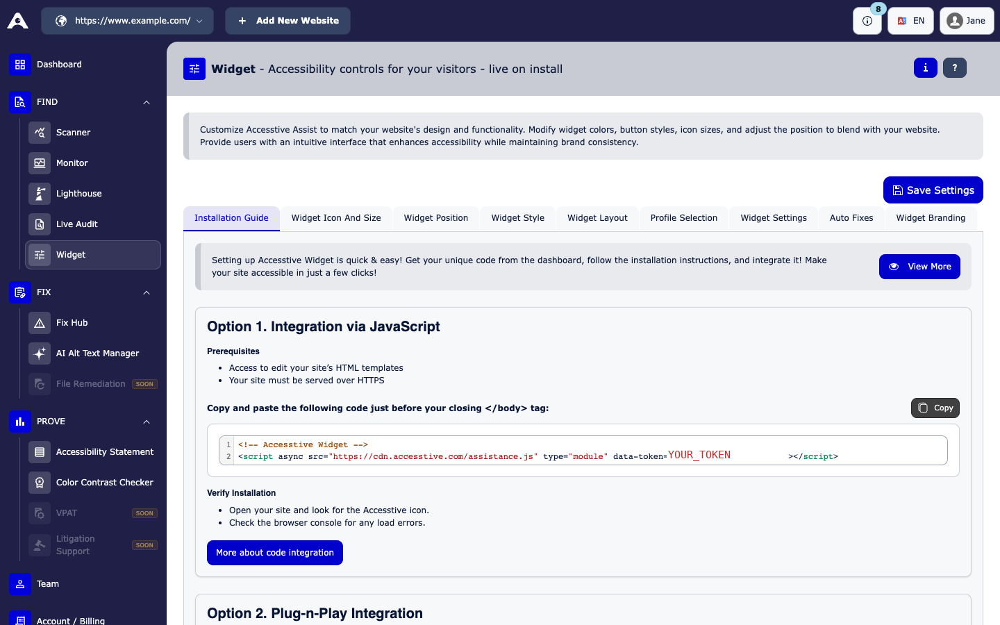

This guide takes you from sign-up to your first accessibility check. It takes about 10 minutes.

## Before you begin

You need:

- A website you can edit (HTML templates, or admin access to your CMS or shop)
- A website served over HTTPS
- A website that anyone can open. Sites behind a password prompt (HTTP authentication) cannot be checked.

## Create an account and sign in

<Steps>
  <Step title="Create your account">
    Open the [Accesstive login page](https://dashboard.accesstive.com/app/) and click **Create Account**. You are taken to the free trial sign-up on accesstive.com. Enter your details and your website address, including `https://`.
  </Step>
  <Step title="Sign in">
    Back on the login page, enter your **Email** and **Password**, then click **LOGIN**. If you forgot your password, click **Forgot your password?**.

    <Frame caption="The Accesstive login page">
      
    </Frame>
  </Step>
  <Step title="Start on the dashboard">
    After you sign in, you land on the **Dashboard**. New sign-ups get a **14-day Starter trial**, no card needed. A banner shows how many trial days you have left.
  </Step>
</Steps>

<Frame caption="The dashboard after you sign in">
  
</Frame>

## Add Accesstive to your website

In the dashboard, open **FIND** → **Widget** → **Installation Guide**. It shows three options. Pick the one that fits your website.

### Option 1: Add the script (any website)

<Steps>
  <Step title="Copy your code">
    In **Installation Guide**, click **Copy**. Your code looks like this. The `data-token` value is unique to your website:

    ```html
    <!-- Accesstive Widget -->
    <script
      async
      src="https://cdn.accesstive.com/assistance.js"
      type="module"
      data-token="YOUR_TOKEN"
    ></script>
    ```
  </Step>
  <Step title="Paste it into your website">
    Paste the code just before the closing `</body>` tag of your website template, so it loads on every page. Then publish the change.
  </Step>
  <Step title="Check that it works">
    Open your website and look for the Accesstive icon. If it does not appear, open your browser's developer console and look for load errors.
  </Step>
</Steps>

<Frame caption="FIND → Widget → Installation Guide (token hidden)">
  
</Frame>

### Option 2: Plugin or app (no coding)

Accesstive has plugins and apps for WordPress, Shopify, Magento, Wix, Squarespace, and more. For example:

- **WordPress**: In your WordPress admin, go to **Plugins** → **Add New**, search for "Accesstive Assistant", click **Install Now**, then **Activate**.
- **Shopify**: In Shopify admin, go to **Apps** → **Shopify App Store**, search for "Accesstive Assistant", and click **Add app**. Follow the prompts.

After activation, the widget loads by itself. You manage the plugin in your platform's admin. See all platforms on the [integrations page](https://accesstive.com/integration/).

### Option 3: Host it on your own server

If you need full control, Accesstive can provide a self-hosting package and help you set it up. Click **Contact Support for Self-Hosting** in the **Installation Guide**.

<Tip>
  You can also add the code from Option 1 with Google Tag Manager: create a **Custom HTML** tag, paste the code, set the trigger to **All Pages**, and publish.
</Tip>

## Run your first check

<Steps>
  <Step title="Use the onboarding strip">
    On the **Dashboard**, the **Get started with Accesstive** strip shows four steps. You can close it at any time and open it again with the Plus (+) icon.
  </Step>
  <Step title="Check your website">
    Click **Start monitoring** in the strip, or open **FIND** → **Scanner**. Click **Run Accessibility Check**. See [Scanner and Monitor](/monitor) for details.
  </Step>
  <Step title="Open Fix Hub">
    When the check is done, open **FIX** → **Fix Hub** to assign and fix the issues found.
  </Step>
</Steps>

## Next steps

- Customize the [Accessibility Widget](/widget)
- Check a page with [Live Audit](/live-audit)
- Add pages to the [Monitor](/monitor)
- Work through issues in [Fix Hub](/fix-hub)
- Invite your [team](/team)
- Review [plans and billing](/billing)

Need help? See [Troubleshooting](/faq#troubleshooting), email [info@accesstive.com](mailto:info@accesstive.com), or call +49 351 48 19 66 61.
