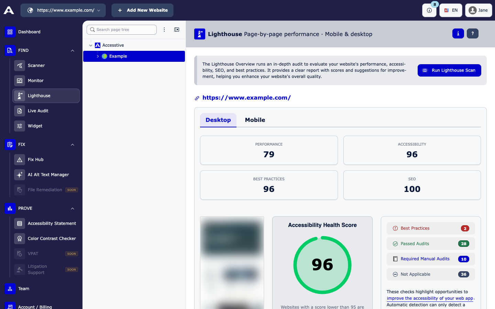

**Lighthouse** gives each page four scores from Google Lighthouse: **Performance**, **Accessibility**, **Best Practices**, and **SEO**. Use it to see the overall quality of a page, not only accessibility.

## Run a Lighthouse scan

<Steps>
  <Step title="Open Lighthouse">
    Go to **FIND** → **Lighthouse**.
  </Step>
  <Step title="Choose a page">
    Click your website or a page in the page tree.
  </Step>
  <Step title="Start the scan">
    If the page has no data yet, you see a message that the page is not scanned yet. Click **Run Lighthouse Scan**. You get a notification when the scan has started and when it is completed.
  </Step>
  <Step title="Read the scores">
    See the four scores and the **Last check** date. Switch between **Mobile** and **Desktop** results.
  </Step>
</Steps>

<Frame caption="FIND → Lighthouse">
  
</Frame>

## What the report shows

- **Critical Issues**: the most important problems on the page
- **Passed Audits**: checks the page passed
- **Required Manual Audits**: checks a person must do by hand
- **Not Applicable**: checks that do not apply to this page

## Rating history

See how your scores change over time. **Rating history for desktop** and **Rating history for mobile** show the average of all Lighthouse runs. Choose the time range: **Two Weeks**, **One Month**, two months (**Two Month**), or **One Year**.

<Note>
  Scores can differ slightly from other Lighthouse tools, because results change from run to run. A Lighthouse score is a quality indicator, not proof of legal compliance.
</Note>

## Lighthouse or Scanner?

The Lighthouse **Accessibility** score is a short summary. For a full list of accessibility issues and fixes, use [Scanner and Monitor](/monitor) and [Fix Hub](/fix-hub).
