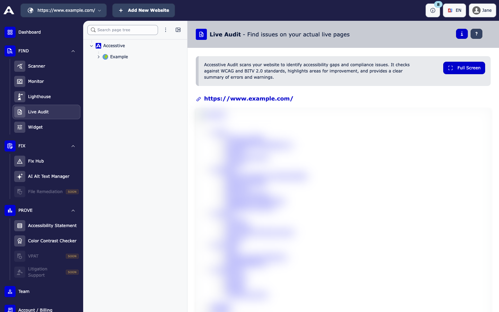

**Live Audit** opens a page of your website and shows its accessibility issues directly on the page. For each issue you see the affected element, how serious it is, which WCAG rule it breaks, who it affects, and an AI suggestion for how to fix it.

You may also see it called **Live AI Audit**.

## Run a Live Audit in the dashboard

<Steps>
  <Step title="Open Live Audit">
    Go to **FIND** → **Live Audit**.
  </Step>
  <Step title="Choose a page">
    In the page tree, click the page you want to check. Your page opens inside the dashboard with the Accesstive audit panel next to it.
  </Step>
  <Step title="Review the issues">
    Click an issue in the panel to highlight the element on the page and read the fix suggestion. Use **Full Screen** for more space, and **Exit Full Screen** to go back.
  </Step>
</Steps>

<Frame caption="FIND → Live Audit (page preview blurred for privacy)">
  
</Frame>

<Note>
  On the **Solo** plan, Live Audit works on your home page only (the top entry in the page tree). On all other plans, you can audit every page of your website.
</Note>

## Run a free Live Audit without an account

1. Open the [free Live Audit](https://accesstive.com/live-audit/) page.
2. Enter the address of a public page.
3. Review the results on your page.

No account or installation is needed.

## What you see for each issue

- The exact element on the page
- Severity: **Critical**, **Serious**, **Moderate**, or **Minor**, plus checks that **Passed** and **Best Practice** tips
- The WCAG rule that applies
- Which users are affected
- The related source code
- An AI suggestion for the fix

You can filter the results by WCAG version and level (WCAG 2.0, 2.1, and 2.2, at levels A, AA, and AAA) and by type of disability.

## Download or share the results

- **PDF report**: click the PDF button in the audit panel to download a report of the results. The first time, you are asked to confirm your email address.
- **Share**: click the Share button to copy a link to the audit and send it to a colleague.

## Live Audit, Scanner, and Monitor: what is the difference?

| | Live Audit | Scanner | Monitor |
| --- | --- | --- | --- |
| What it shows | Issues highlighted on the live page | A rating and issue lists for a page | Repeated checks of chosen pages |
| When to use | To understand and fix one page | To check a page right now | To catch new problems over time |

See [Scanner and Monitor](/monitor).

## When Live Audit cannot run

| You see | What to do |
| --- | --- |
| "The URL is secured with HTTP Basic Authentication, which prevents this feature from working." | Remove the password prompt from the site, or audit a public copy. |
| "Your subscription has ended." | Renew your plan in [Account / Billing](/billing). |
| "Feature Available in Higher Plan, Upgrade to Continue!" | On the Solo plan, choose your home page, or upgrade to audit other pages. |

## Good to know

<Warning>
  Live Audit finds issues that a tool can detect. Some problems, such as screen reader flow or complex keyboard behavior, need a person to confirm. See [Human Expert Audit](/human-expert-audit).
</Warning>

Run Live Audit again after you deploy code or change content, because any change can add new issues.

## Related

- [Fix Hub](/fix-hub) to assign and close issues
- [Scanner and Monitor](/monitor) for repeated checks
- Product page: [Live Audit](https://accesstive.com/live-audit/)
