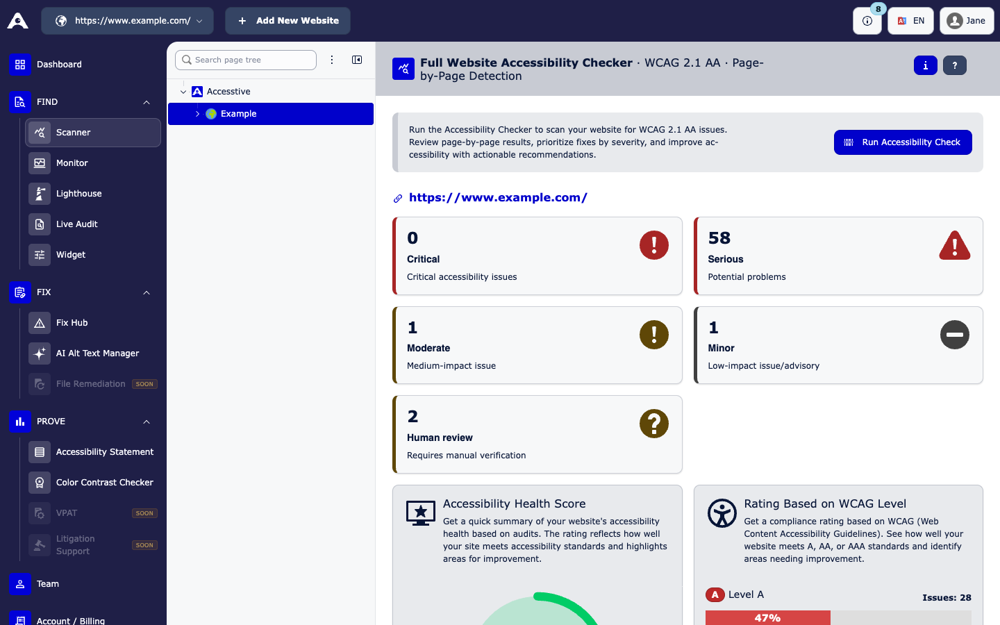
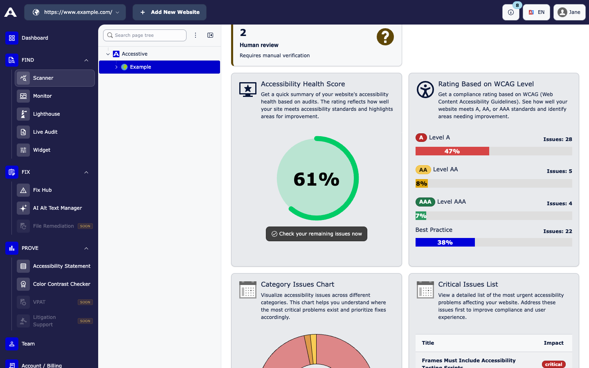
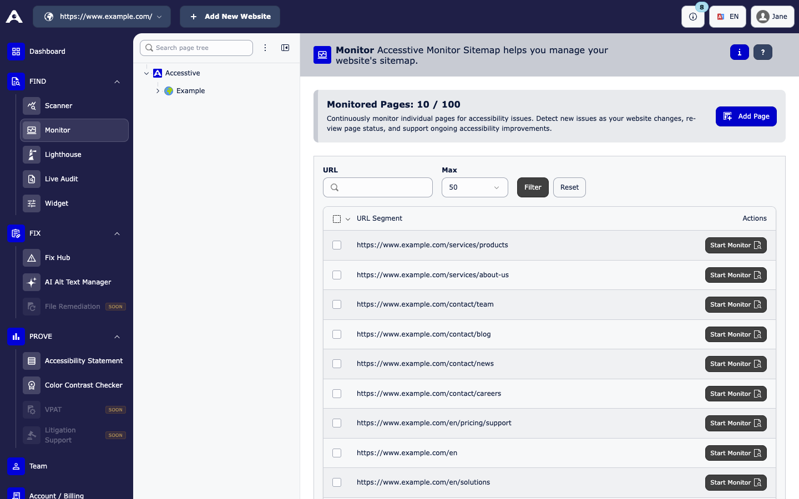
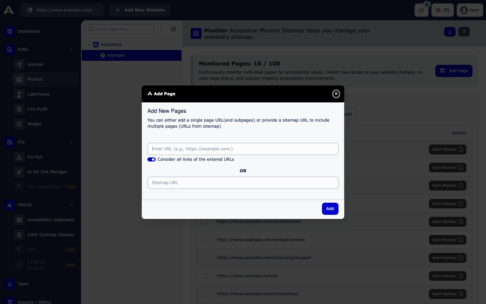

Accesstive has two tools for checking pages automatically. Both are under **FIND** in the dashboard:

| Tool | Use it to |
| --- | --- |
| **Scanner** | Check a page now and get an accessibility rating with a list of issues. |
| **Monitor** | Choose the pages that Accesstive checks again and again, so you notice new problems after website changes. |

Both tools check pages against WCAG rules at levels A, AA, and AAA. Issues found go to [Fix Hub](/fix-hub).

{/* TODO for product team: the dashboard says "WCAG 2.1 AA", the marketing site says "WCAG 2.2 AA". Confirm the version and name it here. */}

## Check a page with the Scanner

<Steps>
  <Step title="Open the Scanner">
    Go to **FIND** → **Scanner**.
  </Step>
  <Step title="Choose a page">
    In the page tree, click your website (the top entry) or one of its pages.
  </Step>
  <Step title="Run the check">
    Click **Run Accessibility Check**. A progress bar shows while the page is being checked. This can take a minute or more for large pages.
  </Step>
  <Step title="Read the results">
    When the check is done, the page shows:

    - Issue counts by severity: **Critical**, **Serious**, **Moderate**, **Minor**, and **Human review**
    - **Accessibility Health Score**: one score that sums up the result
    - **Rating Based on WCAG Level**: how well the page meets levels A, AA, and AAA
    - **Category Issues Chart**: which kinds of problems you have most
    - **Critical Issues List** and **Serious Issues List**: the most urgent problems to fix first
  </Step>
</Steps>

<Frame caption="FIND → Scanner">
  
</Frame>

<Frame caption="Scanner scores further down the page">
  
</Frame>

<Warning>
  Each check uses page credits from your plan. If you see "You've reached today's scan limit. Please try again tomorrow.", wait until the next day or upgrade your plan.
</Warning>

## Keep pages under watch with the Monitor

Monitored pages are checked again automatically on a regular schedule (daily on current plans). This helps you catch new issues when content or code changes.

### Add pages

<Steps>
  <Step title="Open the Monitor">
    Go to **FIND** → **Monitor**. You see the list of your website's pages and how many pages you monitor, for example **Monitored Pages: 10 / 100**. Use the **URL** filter to find a page.
  </Step>
  <Step title="Add new pages">
    Click **Add Page**. In **Add New Pages**, either:

    - enter one page address (and turn on **Consider all links of the entered URLs** to include its subpages), **or**
    - enter the address of your sitemap to add many pages at once.

    The address must start with your website address, for example `https://www.example.com/contact`. Click **Add**.
  </Step>
  <Step title="Start monitoring a page">
    In the page list, click **Start Monitor** next to the page. Accesstive checks it and keeps checking it from now on.
  </Step>
  <Step title="Open the report">
    Click **View Report** next to a monitored page to see its score and issues.
  </Step>
</Steps>

<Frame caption="FIND → Monitor">
  
</Frame>
<Frame caption="The Add New Pages dialog">
  
</Frame>

### How many pages you can monitor

| Plan | Monitored pages |
| --- | --- |
| Free | Not available |
| Solo | 1 |
| Starter | 10 |
| Business | 50 |
| Growth | 100 |

If you reach your limit, the dashboard shows **Upgrade required**. See [Plans and billing](/billing).

### Common messages

| Message | What it means |
| --- | --- |
| "This page already exists." | The page is already in your list. |
| "The URL must start with your base website address." | The address belongs to another website. Use a page of your own website. |
| "Adding monitored pages is not available on the Free plan." | Upgrade to a paid plan to monitor pages. |
| "To monitor more pages, upgrade your plan." | You have used all monitored pages in your plan. |
| "The accessibility check did not return a report." | The check failed. Try again later. If it keeps failing, contact support. |

## What to do next

- Fix the issues in [Fix Hub](/fix-hub).
- Look at a page in context with [Live Audit](/live-audit).
- Check performance and SEO too with [Lighthouse](/lighthouse).

## Related

- [Dashboard tour](/dashboard)
- Product page: [Monitor](https://accesstive.com/monitor/)
