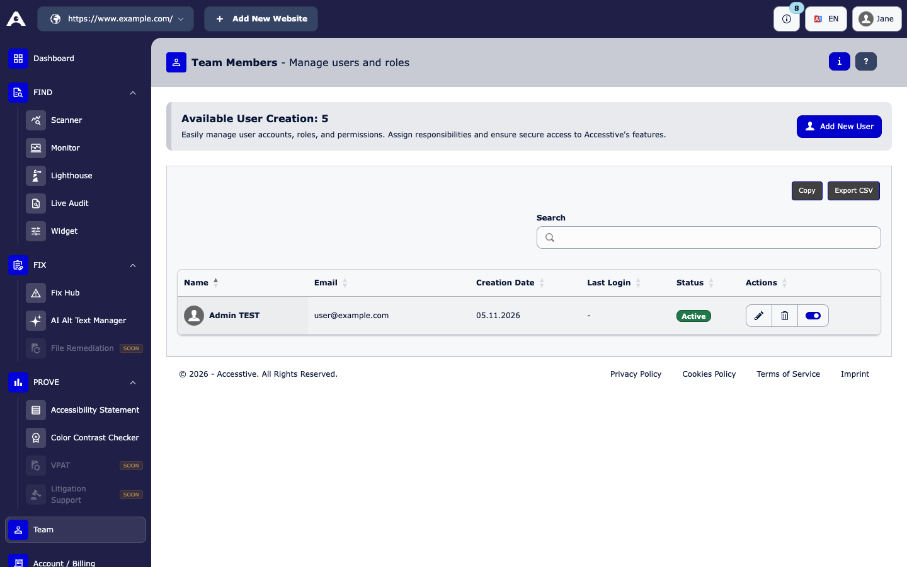
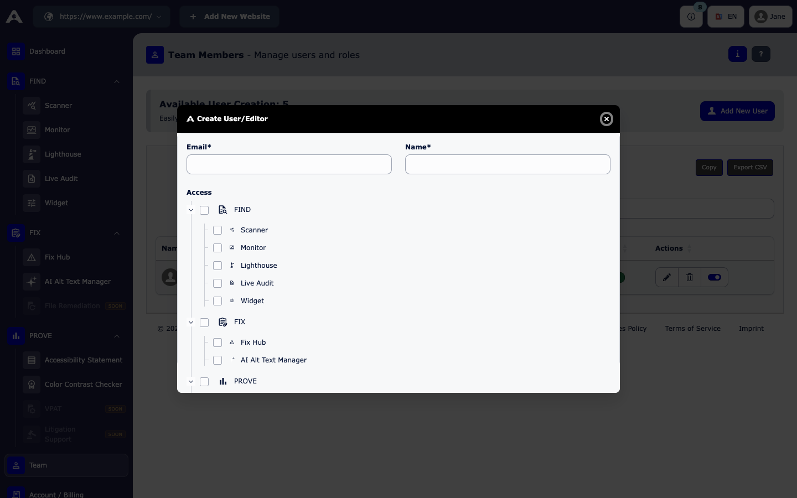

Use **Team** to give colleagues their own login. You choose which parts of the dashboard each person can use. Teammates appear in [Fix Hub](/fix-hub) so you can assign issues to them.

## Add a teammate

<Steps>
  <Step title="Open Team">
    Click **Team** in the left menu. The page shows your team list and **Available User Creation**, which is how many more people you can add.
  </Step>
  <Step title="Add the person">
    Click **Add New User**. Enter their **Name** and **Email**.
  </Step>
  <Step title="Choose their access">
    Under **Access**, tick the modules this person may use, for example **Fix Hub** only for a developer. Click **Save**.
  </Step>
  <Step title="They get an email">
    You see "The Editor has been successfully created, and the necessary credentials will be provided to the recipient via email." Your teammate receives their login details by email.
  </Step>
</Steps>

<Frame caption="Team">
  
</Frame>
<Frame caption="Add New User">
  
</Frame>

## Manage teammates

The team list shows each person's **Name**, **Email**, **Status**, **Creation Date**, and **Last Login**. Under **Actions** you can:

- **Edit** a teammate's name or access
- Switch a teammate between **Active** and **InActive** to pause their login without deleting them
- **Remove** a teammate. This frees up a place on your plan.

## How many users you can have

| Plan | Users |
| --- | --- |
| Solo | 1 (only you) |
| Starter | 1 |
| Business | 3 |
| Growth | 5 |

Numbers as shown on the [pricing page](https://accesstive.com/pricing/). **Available User Creation** on the Team page shows how many more people you can add right now.

If you reach the limit, you see **Upgrade required**: "To add more users, upgrade your plan." See [Plans and billing](/billing).

<Note>
  When your plan has expired, you cannot add teammates. Renew your plan first. See [Renew an expired plan](/billing#renew-an-expired-plan).
</Note>

## Common messages

| Message | What to do |
| --- | --- |
| "This username already exists. Please try a different one." | This email already has an Accesstive login. Use another email. |
| "To add more users, upgrade your plan." | You used all team places. Remove someone or upgrade. |
| "Editor deleted successfully." | The teammate was removed, and the place is free again. |
