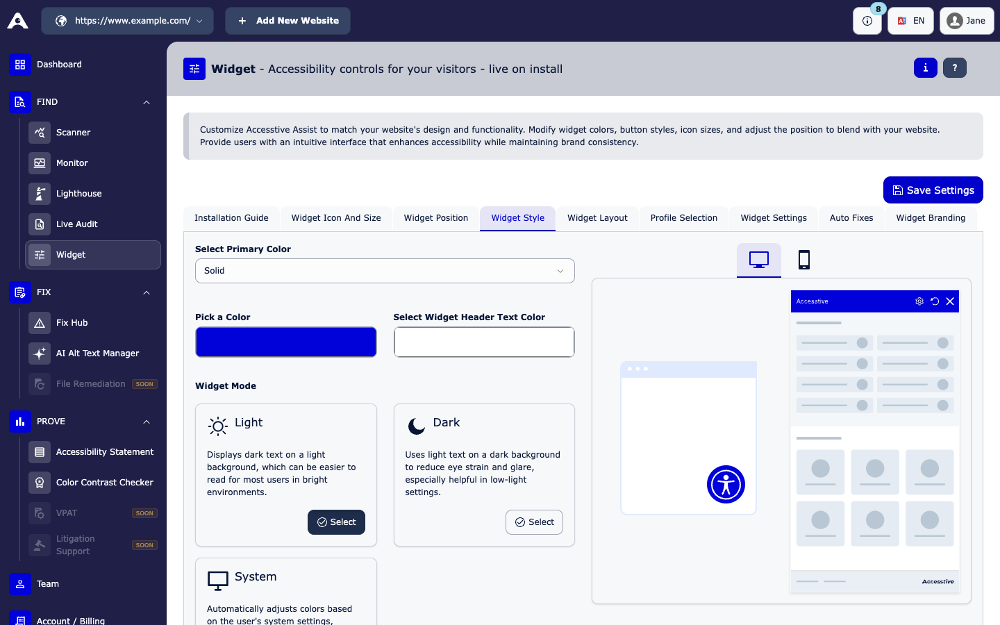

The **Accessibility Widget** (also called **Access Assistant**) adds a small button to your website. Visitors click it to open a panel with tools such as bigger text, stronger contrast, a reading-friendly font, and highlighted links. It is included in every paid plan.

<Warning>
  The widget helps visitors, but it does not make your website compliant on its own. Use it together with [Scanner and Monitor](/monitor), [Fix Hub](/fix-hub), and expert review.
</Warning>

## What visitors can do

The widget has more than 40 tools. You choose which ones visitors see (see [Turn single features on or off](#turn-single-features-on-or-off)).

| Group | Tools |
| --- | --- |
| **Text and reading** | Font size, zoom in and out, readable font (including a dyslexia-friendly font), font weight, line height, letter spacing, word spacing, text alignment, text magnifier, highlight headings, highlight links, dictionary, page summary, reading mode |
| **Color and contrast** | Contrast, smart contrast, saturation, grayscale, invert colors, blur, blue-light filter (also by time or by sun position), color-blindness filters, dark and light mode, custom colors |
| **Focus and navigation** | Keyboard navigation, page structure (headings, landmarks, links), reading guide, reading mask, mouse grid, enlarge buttons, cursor size and color, slow cursor |
| **Sound, motion, and media** | Pause animations, mute sounds, hide images and media, captions |
| **Voice and input** | Screen reader (read aloud), voice navigation (control the page by voice), talk and type (dictation), virtual keyboard |
| **More** | Sign language font (shows text as fingerspelling hand signs), image descriptions, widget language |

Visitors can also pick a ready-made **profile** that turns on several settings at once: Blind, Low Vision, Color Blind, Dyslexia, Cognitive and Learning, ADHD, Seizure and Epileptic, Epilepsy, Motor Impaired, Elder, and Parkinson's Disease.

### Privacy

The widget does **not** set cookies. A visitor's choices are saved only in their own browser (local storage), so the settings stay when they move to another page or come back later. Visitors can undo all their changes with the **Reset** button in the widget.

## Open the widget settings

In the dashboard, open **FIND** → **Widget**. The page has tabs along the top. Make your changes, then click **Save Settings**. Your website shows the new settings on the next page load.

<Frame caption="FIND → Widget → Widget Style">
  
</Frame>

| Tab | What you can change |
| --- | --- |
| **Installation Guide** | Copy your install code and see other ways to install. See [Install the widget](#install-the-widget). |
| **Widget Icon and Size** | Choose the button icon and its size: small, medium, or large. |
| **Widget Position** | Place the button separately for **Desktop** and **Mobile**: left or right, at the top, middle, or bottom. Use **Exact Positioning (5px - 500px)** for fine control, or hide the button on desktop or mobile. |
| **Widget Style** | Choose the main color (solid or gradient), the text color, and the **Widget Mode**: Light, Dark, or System (follows the visitor's device). |
| **Widget Layout** | Choose how the panel looks: **Simple**, **Flexible**, **Minimal**, or **3 Column** layout. |
| **Profile Selection** | Choose which profiles visitors can pick. |
| **Widget Settings** | Turn on extra options: **Move/Drag Widget** (not on mobile), **Widget Large**, **Widget Tooltip**, **Widget Mode** switch, and the widget language. |
| **Auto Fixes** | Let the widget fix common code problems on your pages. See [Auto Fixes](#auto-fixes). |
| **Widget Branding** | Show your own brand name, website, and logo in the widget (white-label). This tab is shown on the **Growth** plan only. |

Some options show an **Upgrade** button. They are not part of your current plan. See [Plans and billing](/billing).

### Turn single features on or off

Below the tabs you find a card for each widget feature. Use its switch to show or hide that feature for your visitors, then click **Save Settings**.

### Widget languages

The widget is available in English, German, Danish, Dutch, French, Italian, Polish, Portuguese, Russian, Spanish, Swedish, and Turkish. In **Widget Settings**, choose a fixed language under **Select Widget Language**, or keep **Default** to follow your website's language.

## Auto Fixes

When you turn on **Auto Fixes** and save, the widget repairs common accessibility problems in your page code each time a page loads. It can add:

- Image descriptions where they are missing or empty (it does not replace existing descriptions)
- Names for unnamed graphics, links, and buttons
- Form labels and required-field markers
- Names for unlabeled fieldsets
- Table headers
- Hidden decorative icons inside named controls
- Heading markup for text that looks like a heading
- Titles for iframes
- Names for video and audio
- An "opens in a new window" hint for links that open a new tab
- Keyboard access for clickable areas
- The page language, when it is missing

To stop Auto Fixes, turn the switch off and click **Save Settings**.

<Note>
  Auto Fixes only change what the visitor's browser shows. They do not change your website's source code. Fix the source too, using [Fix Hub](/fix-hub).
</Note>

## Install the widget

Open **FIND** → **Widget** → **Installation Guide** and click **Copy**. Then paste the code just before the closing `</body>` tag of your website template:

```html
<!-- Accesstive Widget -->
<script
  async
  src="https://cdn.accesstive.com/assistance.js"
  type="module"
  data-token="YOUR_TOKEN"
></script>
```

Always use the code from your own dashboard. The `data-token` value connects the widget to your website and your settings.

Other ways to install:

- **Plugin or app**: WordPress, Shopify, and other platforms. See [Getting started](/getting-started#option-2-plugin-or-app-no-coding).
- **Google Tag Manager**: a Custom HTML tag on All Pages. See [Getting started](/getting-started#add-accesstive-to-your-website).
- **Self-hosting**: Accesstive provides a package for your own server. Contact support from the **Installation Guide**.

## Check the installation

1. Open your website and look for the Accesstive button.
2. Click it and try a profile or a feature.
3. If the button does not show, check the browser console for errors and make sure the code is on every page.

<Note>
  The `www` and non-`www` versions of your domain count as the same website. You do not need to set up the widget twice.
</Note>

## Page limits

Each plan covers the widget on a set number of pages on your website. See [Plans and billing](/billing#what-each-plan-includes). If your website grows past this limit, the Accesstive team contacts you about upgrading.

## Learn more

- [Accessibility Statement](/accessibility-statement): show a link to your statement inside the widget
- Product page: [Accessibility Widget](https://accesstive.com/accessibility-widget/)
